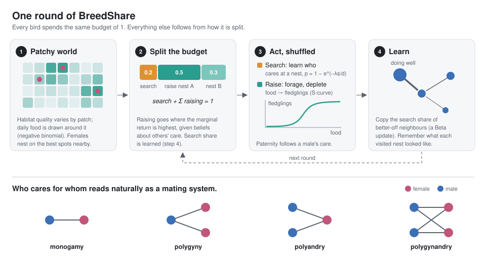
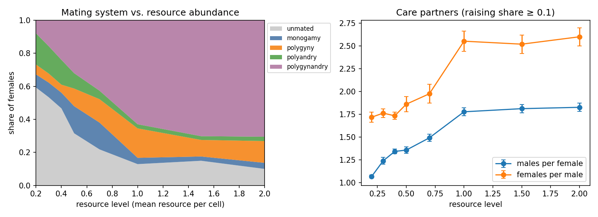

# BreedShare

**An agent-based model of how resource distribution shapes bird mating systems, built on one idea: every reproductive behaviour is a way of spending the same finite energy.**

A female dunnock can stay with one male, share her nest with two, or end up with none. A male can stay with one female or split his care across several. BreedShare does not model each of these choices as its own rule. It treats them all as one decision: how to divide a fixed budget between **searching** (finding out what is going on at other nests) and **raising** (caring for specific nests).

$$
\text{search\_share} + \sum_k \text{raising\_share}_k = 1
$$

The care links that birds choose read naturally as monogamy, polygyny, polyandry and polygynandry.



## What it shows



- **Resource abundance alone reorganises the mating system.** In poor habitats, males concentrate on the few females with good territories: most females get no male help, and the ones that do often have two (polyandry). In rich habitats, a nest needs little help to succeed, so males spread their care, and most females share their males with other females (polygynandry).
- **This half-matches the dunnock data.** Polyandry is commonest where food is poor, as Davies & Lundberg (1984) found. But they found that fed females end up with *fewer* males, while the model gives them more. The model lacks a way for one male to keep others out, and the mismatch shows that this is needed. That is the next step ([ROADMAP](ROADMAP.md)).
- **The cost of information barely matters, against the original hypothesis.** Varying search efficiency λ by a factor of 300 changes almost nothing, because a male learns what he needs from the nests he already cares for.

Details, numbers and caveats: **[docs/results.md](docs/results.md)**. The reasoning behind each modelling choice: **[docs/model.md](docs/model.md)**.

## What is in the model

- **Patchy world.** Habitat quality varies by patch (gamma-distributed), and daily resources are drawn around it (Poisson), so each cell is negative binomial. Abundance and aggregation are separate parameters.
- **Cheap and costly information.** Where nests are is free (birds hear song). Who is caring for them, and how much, is learned only by being there or by a successful search, and search is harder the farther away the nest is.
- **Learning from neighbours.** Birds adjust how much they search by Bayesian updating on the search shares of better-off same-sex neighbours.
- **Best response to beliefs.** Given what it believes others invest, each bird splits its raising energy across nests by equalising marginal returns, and moves half-way there each round (site fidelity).
- **Travel and depletion.** Care loses energy on the way to distant nests. Foraging removes resources, so neighbouring ranges compete, and the shuffled order of actions matters.
- **Fledglings as payoff.** Resources become fledglings through an S-shaped curve; males are credited in proportion to their care.

## Quick start

Requires Python 3.9+.

```bash
git clone https://github.com/lucas-shuo-han/BreedShare.git
cd BreedShare
pip install -r requirements.txt
python main.py
```

`main.py` prints the share of females in each mating system as the population settles. Try `python main.py --resource-level 0.2` or `--resource-level 1.5`, and `python main.py --help` for the other options.

To reproduce every figure (a few minutes on a laptop):

```bash
python experiments/run_experiments.py
```

To run the tests:

```bash
python -m pytest
```

## Documentation

| Document | What it covers |
|---|---|
| [docs/model.md](docs/model.md) | The model, and the reasoning behind each assumption |
| [docs/results.md](docs/results.md) | Experiments, figures and what they mean |
| [docs/architecture.md](docs/architecture.md) | How the code is organised |
| [ROADMAP.md](ROADMAP.md) | Known limitations and next steps |

## Author

Lucas Shuo Han — model design and implementation.

## License

MIT. See [LICENSE](LICENSE).
