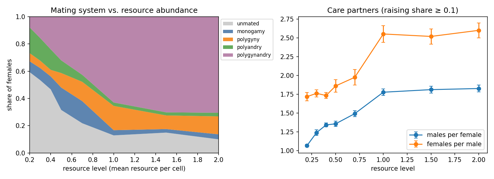
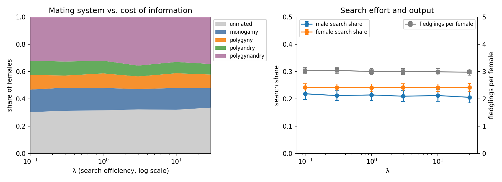
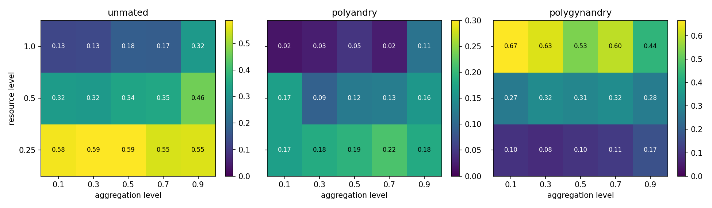
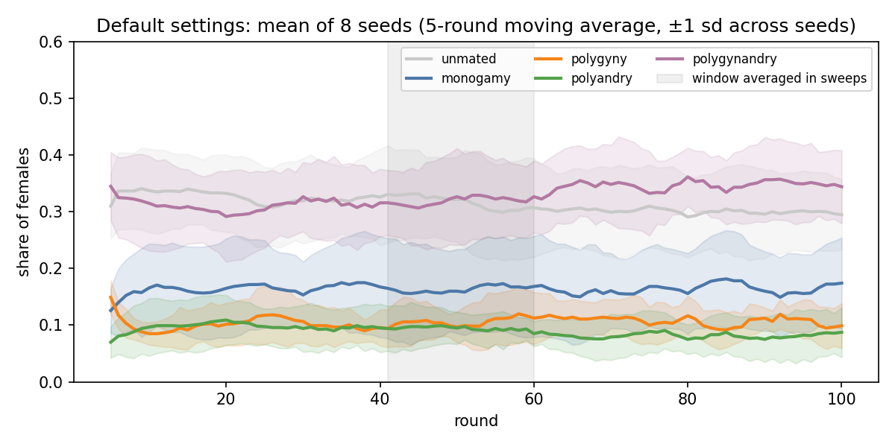

# Results

What the model produces with the defaults in [model.md §8](model.md#8-parameters), and what that says about the model. Every number and figure here comes from `python experiments/run_experiments.py`; the raw values are in `results/*.csv`.

---

## 1. How results are measured

- **Population:** 30 females and 30 males on a 200 × 200 grid.
- **Runs:** 60 rounds each; the reported value is the mean of rounds 41–60 ([§5](#5-convergence) shows the population has settled by then).
- **Seeds:** 8 per setting. Error bars are standard errors across seeds.
- **Mating system:** each female is classified by the males whose care for her nest is at least 0.1 of their budget, and by whether those males also care for other females:

| Category | Males caring for her | Do they also care for other females? |
|---|---|---|
| unmated | 0 | – |
| monogamy | 1 | no |
| polygyny | 1 | yes |
| polyandry | 2+ | none of them |
| polygynandry | 2+ | at least one |

"Unmated" here means "raising alone": the female still breeds, with no male help.

---

## 2. Resource abundance

| Resource level | Unmated | Monogamy | Polygyny | Polyandry | Polygynandry | Males per female | Fledglings per female |
|---|---|---|---|---|---|---|---|
| 0.2 | 0.59 | 0.08 | 0.06 | 0.19 | 0.08 | 1.07 | 0.94 |
| 0.3 | 0.53 | 0.09 | 0.05 | 0.17 | 0.16 | 1.24 | 1.57 |
| 0.5 | 0.32 | 0.16 | 0.11 | 0.09 | 0.32 | 1.36 | 3.00 |
| 0.7 | 0.22 | 0.16 | 0.14 | 0.05 | 0.43 | 1.49 | 3.77 |
| 1.0 | 0.13 | 0.04 | 0.18 | 0.03 | 0.63 | 1.78 | 4.62 |
| 2.0 | 0.10 | 0.04 | 0.13 | 0.03 | 0.71 | 1.83 | 4.99 |

"Males per female" counts only females with at least one male.

**What happens.** Abundance alone moves the population through very different mating systems.

- **Poor habitats:** males concentrate. On the S-shaped fledgling curve, a nest in poor habitat produces almost nothing until it gets a lot of care, so a male gains most by putting all his care where it can lift a nest over the steep part. That means the females with the best territories, often two males per female. Across females, habitat quality and number of males are strongly correlated (r ≈ 0.65 at resource level 0.25, mean over 8 seeds). Most other females raise alone.
- **Rich habitats:** males spread. A female's own effort already gets her nest most of the way up the curve, so a little male care adds a lot of fledglings, and paternity in a nest with no other male is his alone. Spreading care over two or three nearby females pays more than concentrating on one. With every male doing this, most females end up sharing several males: polygynandry.

**Comparison with dunnocks.** Davies & Lundberg (1984) found that polyandry is commonest where food is scarce and female ranges are large, and that fed females had fewer males. The model reproduces the first finding (polyandry is highest in the poorest habitats) but not the second: in rich habitats it predicts *more* males per female.

The mismatch has a clear cause. In the model, any male can care for any reachable nest, and paternity follows care, so no male can stop others sharing "his" female. In dunnocks, the alpha male tries to keep others out, and he succeeds when the female's range is small, which is exactly when food is rich. The model shows that **budget allocation alone is not enough; exclusion is needed to get monogamy and polygyny in rich habitats.** That is the next step ([ROADMAP §1](../ROADMAP.md#1-exclusion-alpha-and-beta-males)).

---

## 3. Cost of information

| λ | Unmated | Monogamy | Polygyny | Polyandry | Polygynandry | Male search share | Fledglings per female |
|---|---|---|---|---|---|---|---|
| 0.1 | 0.30 | 0.17 | 0.11 | 0.10 | 0.32 | 0.22 | 3.03 |
| 1 | 0.32 | 0.16 | 0.11 | 0.09 | 0.32 | 0.21 | 3.00 |
| 10 | 0.32 | 0.16 | 0.11 | 0.08 | 0.33 | 0.21 | 2.99 |
| 30 | 0.34 | 0.14 | 0.10 | 0.08 | 0.34 | 0.21 | 2.98 |

**What happens.** Almost nothing. Across a 300-fold range of λ, every mating-system share stays within a few percentage points, and male search share falls only from 0.22 to 0.21. Both changes are smaller than the differences between seeds.

**Why.** The hypothesis in [model.md §4](model.md#4-information-a-two-tier-structure) was that cheaper information would let birds search less and settle into monogamy and polygyny. It is not supported in this version, because search is worth little here:

- A male always knows the composition of the nests he cares for, which are the ones that matter most to him.
- For other nests, the free population average is already a reasonable guess.
- Site fidelity means allocations change slowly, so even old observations stay roughly right.

With little to gain, birds do not reduce their search much when it gets cheaper. ROADMAP §2 lists ways to make information matter; testing whether any of them restores the predicted effect is the open question.

---

## 4. Resource aggregation

Abundance dominates; aggregation modifies it.

- **In poor habitats, aggregation helps females.** Females settle on the best nearby cells, so when rich patches exist, more of them find one. Fledglings per female rise from 1.1 to 2.1 as aggregation goes from 0.1 to 0.9 at resource level 0.25, while the mating-system shares barely change.
- **In rich habitats, strong aggregation brings back the poor-habitat pattern.** At aggregation 0.9, most of the landscape is poor matrix around a few very rich patches. More females raise alone (0.13 → 0.32 at resource level 1.0), and polyandry reappears (0.02 → 0.11).

So what matters to a male is the habitat around each nest, not the landscape average.

---

## 5. Convergence

Averaged over seeds, the mating-system shares settle within about 10 rounds and then stay level. The mean of rounds 41–60 and the mean of rounds 81–100 differ by at most 0.03 in every category, so averaging rounds 41–60 measures a steady state, not a transient.

Individual runs differ much more than the averages do. At default settings, the unmated share of a single run ranges from 0.19 to 0.48 across seeds, and monogamy from 0.02 to 0.32. Each seed draws its own landscape and starting positions, and a population of 30 females is small. This is why every result here averages 8 seeds and reports standard errors.

---

## 6. What this says about the model

**Supported.** The central idea works: with no mating system coded in, resource conditions alone produce clearly different systems, from concentrated care and polyandry to widespread sharing. They arise from one mechanism, the shape of the fledgling curve under a fixed budget.

**Not supported, and informative.**

- Rich habitats do not produce monogamy, which points to missing exclusion.
- The cost of information has no effect, which points to information being too easy to come by.

**Model behaviour to keep in mind.**

- Female search share does not fall to its minimum, although search gains females nothing in this version. Social learning removes this small waste very slowly, because a female's fitness depends far more on her habitat than on her search share.
- "Unmated" is mostly a choice, not geography. Only about 7% of females have fewer than two males within reach, while in poor habitats over half raise alone.
- Results depend on the fledgling curve's calibration. In average habitat at resource level 0.5, a lone female raises about 0.7 of a possible 5 fledglings; the resource sweep shows how the picture changes as that ratio moves.
